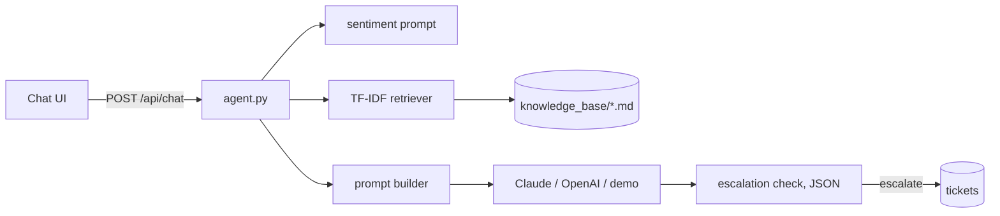

# PromptDesk

[](https://github.com/shubhankar360/promptdesk/actions/workflows/test.yml)

A customer-support chatbot built mostly out of prompts. It answers from a small knowledge base, reads how annoyed the customer is, changes its tone to match, and opens a ticket when it decides it can't help. It's a FastAPI app with a chat page and a small analytics dashboard, and it works with Claude, with OpenAI, or with no key at all.

I built this in July 2026, one of my first LLM projects, to learn prompt engineering properly rather than by copying snippets. It's the simplest repo here; the later ones ([handoff-graph](https://github.com/shubhankar360/handoff-graph), [agentcheck](https://github.com/shubhankar360/agentcheck)) are where I started measuring things instead of asserting them.

## How a message is handled



1. A sentiment prompt labels the message (positive, neutral, frustrated, angry) and is asked to reason before it labels.
2. A TF-IDF retriever I wrote without ML libraries picks the most relevant knowledge-base passages.
3. The answer prompt is assembled from separate blocks (role, guardrails, tone, retrieved passages with their titles), and the tone block changes with the sentiment.
4. A second prompt returns strict JSON saying whether to escalate. It's validated with Pydantic before a ticket is written, so a malformed reply can't open one.

All the prompts are in [`app/prompts.py`](app/prompts.py), and [`docs/PROMPT_ENGINEERING.md`](docs/PROMPT_ENGINEERING.md) explains why each block is there.

## Run it

```bash
git clone https://github.com/shubhankar360/promptdesk.git
cd promptdesk
python -m venv venv && source venv/bin/activate
pip install -r requirements.txt

cp .env.example .env      # optional: add ANTHROPIC_API_KEY or OPENAI_API_KEY
uvicorn app.main:app --reload
```

The chat is at http://localhost:8000 and the dashboard at http://localhost:8000/dashboard. Without a key it runs in demo mode: retrieval still works, and answers are built from the retrieved passages instead of generated.

```bash
pytest     # 19 tests: retriever, prompt assembly, escalation parsing, tickets; no key needed
```

The knowledge base is for a made-up shop called CloudCart (billing, shipping, returns, accounts). Drop your own markdown files into `knowledge_base/` and they're indexed on startup.

## What I haven't measured

I describe what the prompts are for, not how well they work, because I never built a labelled set to check them against. In particular, I don't know whether asking for reasoning before the sentiment label actually improves it, or how often the escalation prompt is right. If I came back to this, I'd label a hundred real-looking messages and score both before touching another prompt. That's the approach I took in the later repos.

## Layout

```
app/main.py        FastAPI routes
app/agent.py       sentiment, then retrieval, then answer, then escalation
app/prompts.py     the prompt library
app/llm.py         Claude / OpenAI / demo client
app/rag.py         TF-IDF retriever, no ML libraries
app/database.py    SQLite: conversations, messages, tickets
knowledge_base/    the documents it answers from
static/            chat page and dashboard
tests/             pytest, runs without a key
```

MIT licensed.
